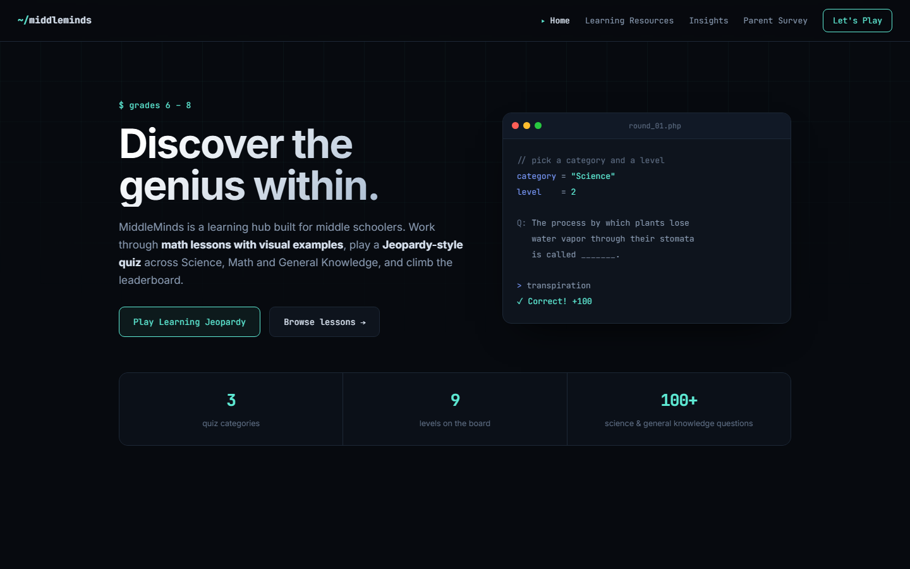
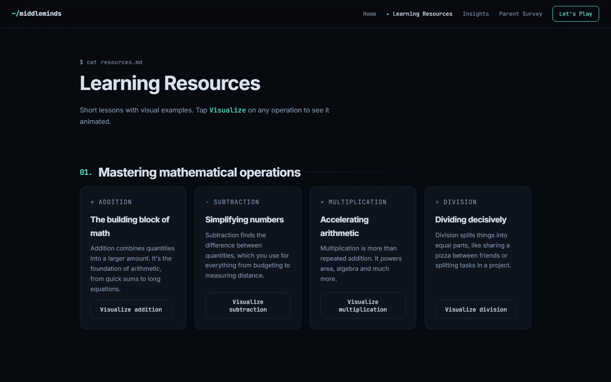
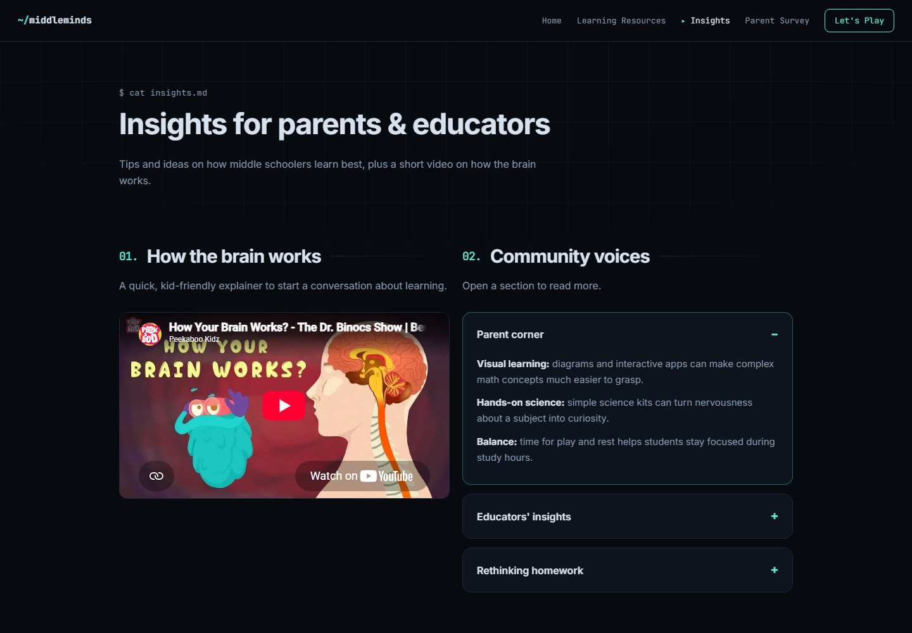
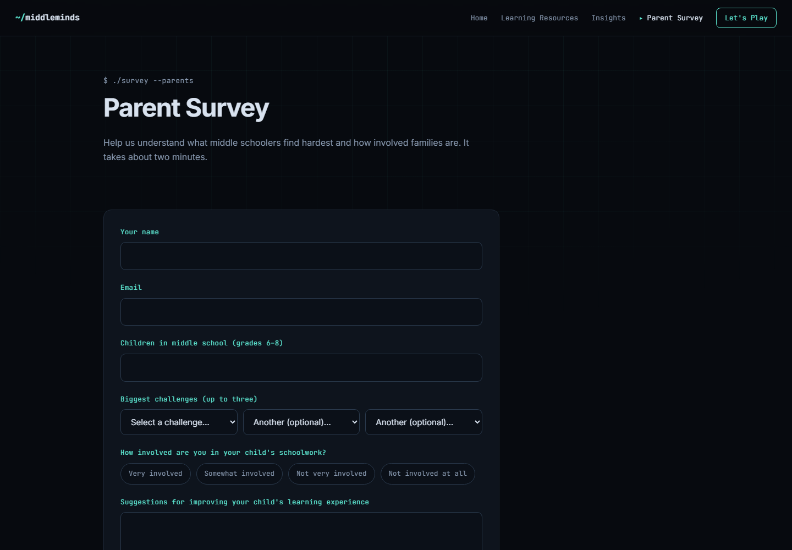

# MiddleMinds — Learning Hub for Middle Schoolers

A learning website for students in grades 6–8, built with **PHP, MySQL, HTML, CSS and JavaScript**.
Students work through math lessons with animated examples, play a Jeopardy-style quiz across
Science, Math and General Knowledge, and see where they land on a leaderboard. Parents can fill in
a short survey about their child's biggest challenges.



## Features

- **Learning Resources:** lessons on addition, subtraction, multiplication and division, each with a
  "Visualize" button that reveals an animated example, plus sections on motion and study habits.
- **Learning Jeopardy:** a 3 × 3 board (Science, Math, General Knowledge × Levels 1–3).
  - 114 Science and General Knowledge questions, picked at random per level.
  - Math questions are generated on the fly, sized to the level, and division always has a whole-number answer.
  - The correct answer stays on the server, so it can't be read from the browser.
  - 100 points per correct answer, 3 rounds per game, and personal bests saved to MySQL.
- **Results & leaderboard:** points by category and the top 10 best scores, with your own row highlighted.
- **Parent Survey:** validated form saved to MySQL through a JSON endpoint with prepared statements.
- **Responsive dark theme** with a mobile menu and scroll-in animations.

## Screenshots

| Learning Resources | Insights |
|---|---|
|  |  |

| Parent Survey |
|---|
|  |

## Project structure

```
index.html  resources.html  insights.html  survey.html
survey_form.php          # saves a survey response (JSON)
game/
  index.php              # enter a player name
  board.php              # 3 × 3 quiz board
  question.php           # serves a question (answer stays in the session)
  submit.php             # checks the answer and updates the score
  end.php                # results and leaderboard
  questions.php          # Science and General Knowledge question banks
includes/db.php          # MySQL connection (env vars or XAMPP defaults)
db/schema.sql            # UserScores and ParentSurvey tables
assets/css  assets/js  assets/media
```

## Running it locally

1. Install [XAMPP](https://www.apachefriends.org/) (or any PHP 8 + MySQL setup) and start Apache and MySQL.
2. Copy this folder into `xampp/htdocs/middleminds`.
3. Create the database: open phpMyAdmin and import `db/schema.sql`, or run
   `mysql -u root < db/schema.sql`.
4. Visit `http://localhost/middleminds/`.

The connection defaults to `root` with no password on `localhost`. To change it, set `DB_HOST`,
`DB_USER`, `DB_PASS` and `DB_NAME`, or edit `includes/db.php`.
